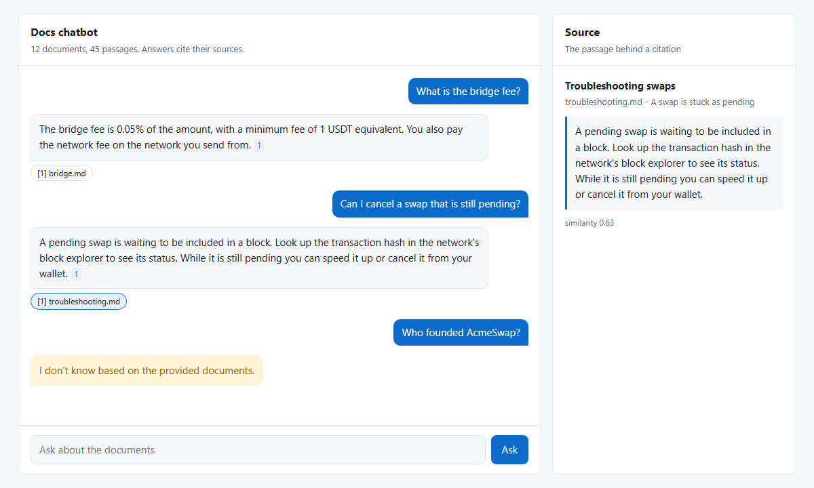
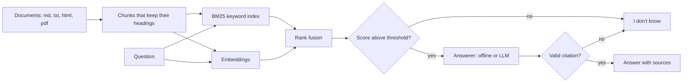

# RAG chatbot with citations

A chatbot that answers questions from your own documents, shows the source behind every answer, and says "I don't know" instead of guessing.

[](https://github.com/alex-pubgit/rag-chatbot-with-citations/actions/workflows/ci.yml)




This is a demo and reference implementation. The sample documents describe AcmeSwap, a fictional product.

## What you get

- Answers built only from your documents: Markdown, text, HTML and PDF.
- A numbered citation on every answer, with the passage it came from one click away.
- A refusal when the documents do not cover the question. An answer without a valid citation is never shown.
- An evaluation command that scores retrieval, answers and refusals against your own list of questions, and can fail a CI build when quality drops.
- Your choice of model: fully offline out of the box, or any OpenAI-compatible endpoint (OpenAI, Ollama, LM Studio, vLLM, OpenRouter) by changing settings.

## Try it in 2 minutes

No account or API key needed. Requires Python 3.11 or newer.

```bash
git clone https://github.com/alex-pubgit/rag-chatbot-with-citations.git
cd rag-chatbot-with-citations
python -m venv .venv
source .venv/bin/activate        # Windows: .venv\Scripts\activate
pip install -e .

ragbot ingest sample_docs
ragbot ask "What is the bridge fee?"
ragbot ask "Who founded AcmeSwap?"
```

```text
Indexed 12 documents as 45 passages in .ragbot
added 12, updated 0, unchanged 0, removed 0

The bridge fee is 0.05% of the amount, with a minimum fee of 1 USDT equivalent. You also pay the network fee on the network you send from. [1]
  [1] bridge.md - Bridge fee (score 0.71)

I don't know based on the provided documents.
```

For the web page in the screenshot, run `ragbot serve` and open http://127.0.0.1:8000.

With Docker instead: `docker compose up --build`, then open http://localhost:8000.

## How it works



1. `ragbot ingest` splits each document into passages along its headings and indexes them twice: by keywords (BM25) and by embeddings.
2. A question is searched in both indexes and the two rankings are fused.
3. If the best passages are not similar enough to the question, the bot refuses. The threshold is calibrated per embedding model.
4. Otherwise an answerer writes the answer from those passages and marks each claim with `[n]`.
5. Every `[n]` is checked against the retrieved passages. Unknown numbers are removed, and an answer left with no valid citation becomes a refusal.

## Use it for your own documents

```bash
ragbot ingest /path/to/your/docs     # run again after documents change; unchanged files are skipped
ragbot serve
```

Then write 20 to 30 questions you know the answers to, plus a few your documents should not answer, in the format of [eval/golden.jsonl](eval/golden.jsonl), and score the bot:

```bash
ragbot eval --golden my-questions.jsonl --calibrate    # suggests a refusal threshold
ragbot eval --golden my-questions.jsonl --compare      # bm25 vs dense vs hybrid
```

### Use a real model

The offline mode quotes passages. For written answers, point the bot at a chat model:

```bash
export RAGBOT_ANSWERER=openai
export RAGBOT_LLM_MODEL=<chat model name>
export RAGBOT_LLM_API_KEY=<your key>
# A local Ollama server instead of OpenAI:
# export RAGBOT_LLM_BASE_URL=http://localhost:11434/v1
```

For semantic search, switch the embedder and ingest again:

```bash
pip install -e ".[fastembed]"        # local model, no key
export RAGBOT_EMBEDDER=fastembed
ragbot ingest /path/to/your/docs
```

`RAGBOT_EMBEDDER=openai` uses any OpenAI-compatible embeddings endpoint. It needs `RAGBOT_EMBEDDING_MODEL` and a calibrated `RAGBOT_MIN_SCORE`.

### API

```bash
curl -s -X POST http://127.0.0.1:8000/ask \
  -H "Content-Type: application/json" \
  -d '{"question": "What is the bridge fee?"}'
```

```json
{
  "answer": "The bridge fee is 0.05% of the amount, with a minimum fee of 1 USDT equivalent. You also pay the network fee on the network you send from. [1]",
  "refused": false,
  "citations": [
    {
      "n": 1,
      "source": "bridge.md",
      "title": "Bridge",
      "heading": "Bridge fee",
      "snippet": "The bridge fee is 0.05% of the amount, with a minimum fee of 1 USDT equivalent. You also pay the network fee on the network you send from.",
      "score": 0.7065
    }
  ],
  "latency_ms": 1
}
```

`GET /sources` lists the indexed documents and `GET /health` reports the index and the active models. `top_k` (1 to 20) is optional in the request.

## Configuration

Settings are environment variables or lines in a `.env` file. [.env.example](.env.example) lists all of them.

| Variable | Default | Meaning |
|---|---|---|
| `RAGBOT_INDEX_DIR` | `.ragbot` | Where the index is stored |
| `RAGBOT_CHUNK_SIZE` / `RAGBOT_CHUNK_OVERLAP` | `120` / `20` | Passage size and overlap, in words |
| `RAGBOT_RETRIEVAL` | `hybrid` | `hybrid`, `bm25` or `dense` |
| `RAGBOT_TOP_K` | `5` | Passages retrieved per question |
| `RAGBOT_MIN_SCORE` | per embedder | Refusal threshold, 0 to 1 |
| `RAGBOT_EMBEDDER` | `hashing` | `hashing`, `fastembed` or `openai` |
| `RAGBOT_ANSWERER` | `extractive` | `extractive` or `openai` |
| `RAGBOT_LLM_MODEL`, `RAGBOT_LLM_BASE_URL`, `RAGBOT_LLM_API_KEY` | | Chat model for `openai` answers |
| `RAGBOT_EMBEDDING_MODEL`, `RAGBOT_EMBEDDING_BASE_URL`, `RAGBOT_EMBEDDING_API_KEY` | | Embedding model for `openai` embeddings |
| `RAGBOT_TIMEOUT_SECONDS` | `30` | Timeout for model endpoints |

## Quality

```bash
pip install -e ".[dev]"
pytest                      # 172 tests, offline, under a second
ruff check . && ruff format --check .
```

### Measured on the sample corpus

Offline answerer, hybrid retrieval, 5 passages per question:

| Embedder | Question set | Hit rate | MRR | Correct answers | Refusal precision | Refusal recall |
|---|---|---|---|---|---|---|
| hashing (default) | dev, 40 | 100% | 0.98 | 80% | 75% | 90% |
| hashing (default) | held-out, 15 | 100% | 1.00 | 70% | 57% | 80% |
| bge-small via fastembed | dev, 40 | 100% | 0.97 | 83% | 75% | 90% |
| bge-small via fastembed | held-out, 15 | 100% | 0.95 | 70% | 71% | 100% |

Reproduce a row with `ragbot ingest sample_docs` followed by `ragbot eval` (add `--golden eval/heldout.jsonl` for the held-out set, and `RAGBOT_EMBEDDER=fastembed` for the second embedder).

- **Hit rate / MRR**: the document that holds the answer is among the retrieved passages, and how high it ranks.
- **Correct answers**: the answer cites the right document and states every expected fact.
- **Refusal recall**: share of unanswerable questions that were refused. **Refusal precision**: share of refusals that were right to refuse.

What the numbers say:

- Retrieval is not the weak point here. Twelve short documents are too easy to separate BM25, embeddings and their combination, so a real embedding model shows no gain. On a larger, messier corpus that changes, which is why the command exists.
- The misses come from the offline answerer. It matches words, so it refuses "How much does bridging cost?" when the page says "fee". It errs toward "I don't know": most wrong refusals are answerable questions phrased differently from the documents.
- I tuned two values on the dev set: the score threshold (with `--calibrate`) and the answerer's coverage threshold. I wrote the held-out questions afterwards and did not tune on them. They score lower, as expected, and 15 questions is a small sample.
- The LLM answerer was not measured: this machine has no API key. The same retrieval, refusal gate and citation check apply to it.

### Tested and not tested

| Part | Status |
|---|---|
| Loading, chunking, BM25, fusion, index storage, citations, refusals, API, CLI | 172 offline tests on Python 3.11 and 3.13 (run locally on Windows; CI runs them on Ubuntu) |
| Evaluation numbers | Measured locally with the commands above. CI enforces a floor on the default configuration |
| Web page | Run locally. The screenshot is a real capture |
| `fastembed` embedder | Run locally with bge-small. Not in the automated tests, because it downloads a model |
| OpenAI-compatible chat and embedding adapters | Tested against mocked HTTP responses only. Not run against a live provider |
| Docker image | Built and smoke-tested by CI. Not run locally |

## Design decisions

- **Refuse before guessing.** Two independent gates: passages below a calibrated similarity score are discarded before any model is called, and a draft with no valid citation is turned into a refusal. The cost is wrong refusals, which the evaluation makes visible.
- **One score for refusals.** Whatever ranked a passage, the score compared with the threshold is the cosine similarity under the configured embedder. BM25 scores are unbounded and corpus-dependent, so a threshold on them would not survive a change of documents.
- **Rank fusion, not score fusion.** BM25 and cosine scores are on different scales. Reciprocal Rank Fusion needs no weights to tune. It ignores how far ahead the top hit is.
- **A NumPy matrix, not a vector database.** Exact search over a few thousand passages takes milliseconds and removes a service from the first run. `VectorStore` is the seam where a database would go. No such integration is included.
- **JSON and `.npy` on disk, never pickle.** Opening an index cannot execute code. BM25 statistics are rebuilt at load instead of stored.
- **An offline answerer that quotes.** It makes the whole pipeline, including refusals and citations, testable in CI with no key. It cannot paraphrase or combine passages.
- **One wire format for hosted models.** The OpenAI-compatible API covers OpenAI and most local servers with a single adapter. There is no native adapter for other vendors' APIs.

## Limitations

- The offline answerer is a keyword baseline. Use an LLM answerer for anything user-facing.
- The citation check proves that `[n]` points at a retrieved passage. It does not prove that the sentence is supported by that passage.
- With an LLM, resistance to instructions hidden inside documents depends on the model. Only the prompt rule and the offline path are tested.
- English only: the tokenizer, stemmer and stopword list are English.
- The API has no authentication or rate limiting. Put it behind your own gateway.
- Search is exact and in memory, and the index is rebuilt by a command, not synced live.

## Project layout

```text
src/ragbot/
  loaders.py, chunking.py    documents -> passages that keep their heading path
  bm25.py, embeddings/       keyword index; hashing, fastembed and OpenAI-compatible embedders
  retrieval.py, fusion.py    hybrid search with Reciprocal Rank Fusion
  answer.py, llm.py          citations, refusals, offline and LLM answerers
  evaluation.py              golden-set scoring and threshold calibration
  api.py, static/, cli.py    FastAPI app, web page, command line
sample_docs/                 fictional help center used by the demo and the tests
eval/                        dev and held-out question sets
```

## Need this adapted to your project?

I build this kind of assistant for real document sets: your sources, your model, deployed where you need it. See [github.com/alex-pubgit](https://github.com/alex-pubgit).

## License

MIT. See [LICENSE](LICENSE).
